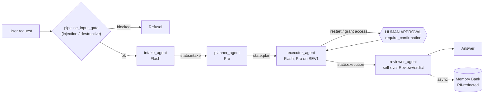

# GEAP Enterprise Ops Agent

A production-style **Google ADK multi-agent system** for enterprise IT operations, built for the GEAP *AI Coding (AI in 5 Days)* assessment.

**Problem:** On-call engineers lose critical minutes during incidents: triaging severity, finding the right runbook, opening tickets, and coordinating risky changes like production restarts or access grants.

**Solution:** A `SequentialAgent` pipeline that **triages, plans, executes, and reviews**. It routes each step to the right Gemini model (Flash or Pro), enforces guardrails at every layer, and **pauses for human approval** before any high-stakes action.



---

## Grading rubric to code map (95 / 95)

### 1. Tool & Interface Design (20 pts)

| Criterion | Where | Evidence |
| :-- | :-- | :-- |
| Comprehensive tool docstrings | [`agent_app/tools.py`](agent_app/tools.py) | Every tool has a Google-style docstring covering purpose, `Args:`, `Returns:`, and error behavior. Enforced by `tests/test_tools.py::test_every_tool_has_comprehensive_docstring`. |
| Descriptive naming | [`agent_app/tools.py`](agent_app/tools.py) | `classify_ops_request`, `get_service_health_status`, `search_runbook_knowledge_base`, `create_incident_ticket`, `restart_production_service`, `grant_temporary_access`. |
| Explicit JSON schemas | [`agent_app/schemas.py`](agent_app/schemas.py) | Strict Pydantic input/output models (`extra="forbid"`, regex patterns, bounds, enums). Inputs are tool parameters, so ADK publishes their JSON Schema to Gemini. Outputs are validated via `*Output` models. `ALL_TOOL_SCHEMAS` is the registry. |
| Guided error handling | [`agent_app/tools.py`](agent_app/tools.py) (`ops_tool`, `ToolExecutionError`), [`agent_app/guardrails.py`](agent_app/guardrails.py) (`handle_tool_error`) | Tools never crash. They return a `ToolError` with `error_code`, `message`, `recovery_instructions`, and `retryable`. ADK `on_tool_error_callback` covers framework-level failures. |

### 2. Context & Memory (20 pts)

| Criterion | Where | Evidence |
| :-- | :-- | :-- |
| Robust system instructions | [`agent_app/prompts.py`](agent_app/prompts.py) | `GLOBAL_CONSTITUTION` (mission, domain knowledge, non-negotiable constraints) is applied as `global_instruction` to every agent. Per-agent instructions inject state (`{intake?}`, `{plan?}`). |
| History compaction | [`agent_app/memory.py`](agent_app/memory.py) | ADK `EventsCompactionConfig` + `LlmEventSummarizer` (Flash) in `build_compaction_config()`, a token-budget sliding window `trim_history()` (before-model), and Gemini `ContextCacheConfig`. Wired into the `App` in [`agent_app/agent.py`](agent_app/agent.py). |
| Persistent session state | [`agent_app/memory.py`](agent_app/memory.py) | `build_session_service()`: `VertexAiSessionService` (Agent Engine) in the cloud, `DatabaseSessionService` (SQLAlchemy / SQLite or Cloud SQL) locally. `build_memory_service()`: `VertexAiMemoryBankService`. `user:` / `app:` scoped state persists across sessions. Verified by `tests/test_e2e_pipeline.py` (reopens the DB). |
| Async memory operations | [`agent_app/memory.py`](agent_app/memory.py) | `consolidate_memory_async` (root `after_agent_callback`) schedules `add_session_to_memory` as a background `asyncio` task (`schedule_memory_consolidation`) on a PII-redacted copy. `tests/test_context_memory.py::test_memory_consolidation_is_non_blocking`. |

### 3. Orchestration & Logic (20 pts)

| Criterion | Where | Evidence |
| :-- | :-- | :-- |
| Multi-agent patterns | [`agent_app/agent.py`](agent_app/agent.py) | `SequentialAgent` `ops_pipeline` with 4 specialist `LlmAgent`s communicating through `output_key` state. |
| Strategic model routing | [`agent_app/routing.py`](agent_app/routing.py) | Static routes (Flash for intake/executor/reviewer, Pro for planner) plus `dynamic_model_router` (before-model) that escalates SEV1/security to Pro and downgrades SEV4 questions to Flash. |
| Guardrails & policy plugins | [`agent_app/guardrails.py`](agent_app/guardrails.py) | `pipeline_input_gate` (root before-agent), `input_safety_guardrail` (before-model: injection, destructive ops, PII), `tool_policy_guardrail` (before-tool: per-agent allowlist, severity policy, rate limit), `output_pii_guardrail` (after-model), ADK `GovernancePlugin(BasePlugin)`, and the `reviewer_agent` **self-evaluation** with a `ReviewVerdict` output schema. |
| Human-in-the-loop hooks | [`agent_app/tools.py`](agent_app/tools.py), [`agent_app/runner.py`](agent_app/runner.py) | `FunctionTool(..., require_confirmation=True)` on `restart_production_service` and `grant_temporary_access`. The tool body double-checks `tool_context.tool_confirmation`. `runner.run_turn` handles `adk_request_confirmation` and asks the human. `ResumabilityConfig(is_resumable=True)` lets the run resume. |

### 4. Observability & Tracing (20 pts)

| Criterion | Where | Evidence |
| :-- | :-- | :-- |
| Structured JSON logging | [`agent_app/observability.py`](agent_app/observability.py) | `JsonFormatter` (Cloud Logging fields: `severity`, `logging.googleapis.com/trace`) via `configure_logging()`. All modules log with structured `extra=` metadata, never `print`. |
| Intent vs. outcome capture | [`agent_app/observability.py`](agent_app/observability.py) | `log_tool_intent` (before-tool) and `log_tool_outcome` (after-tool), correlated by `call_id`, with status and latency. Agent-level `agent.intent` / `agent.outcome`, plus `request.received` / `request.completed` in the plugin and `hitl.decision` in the runner. |
| Distributed tracing | [`agent_app/observability.py`](agent_app/observability.py), [`agent_app/runner.py`](agent_app/runner.py) | OpenTelemetry `TracerProvider` with Cloud Trace exporter. Root span `ops_request` with child `tool.*`, `tool_impl.*`, `memory.consolidate` spans, joined with ADK's native spans. Trace IDs are stamped into every log line. `adk deploy agent_engine --trace_to_cloud`. |
| PII redaction | [`agent_app/pii.py`](agent_app/pii.py) | **Cloud DLP** `deidentify_content` (`redact_with_cloud_dlp`) with **regex fallback** (email, SSN, Luhn-checked cards, phone, IP, API keys). Applied in the logging pipeline (`RedactionFilter`), the memory pipeline (`memory.redact_session`), and model I/O guardrails. |

### 5. Infrastructure & CI/CD (15 pts)

| Criterion | Where | Evidence |
| :-- | :-- | :-- |
| Automated evaluation suites | [`evals/golden_evalset.json`](evals/golden_evalset.json), [`evals/offline_eval.py`](evals/offline_eval.py), [`evals/test_config.json`](evals/test_config.json), [`tests/`](tests) | ADK `EvalSet` golden dataset (10 cases: triage, trajectory, HITL, guardrails). An offline regression harness runs in CI. `adk eval` / `AgentEvaluator` live eval. The pytest suite includes an end-to-end pipeline run with a scripted LLM. |
| Infrastructure as Code | [`terraform/main.tf`](terraform/main.tf), [`agent_app/deploy.py`](agent_app/deploy.py), [`deploy.sh`](deploy.sh) | Terraform provisions APIs, a least-privilege service account, Secret Manager secrets, a staging bucket, and log-based metrics. `agent_app/deploy.py` exposes the Terraform IaC (`TERRAFORM_IAC_RESOURCES`, `terraform_commands`) and the Agent CLI (`adk deploy agent_engine`). |
| CI/CD | [`.github/workflows/ci.yml`](.github/workflows/ci.yml), [`cloudbuild.yaml`](cloudbuild.yaml) | GitHub Actions: pytest, golden eval, secret scan, `terraform fmt/validate`, and keyless (WIF) deploy. Cloud Build: test, then terraform, then `adk deploy agent_engine`. |
| Secure secret management | [`agent_app/config.py`](agent_app/config.py) | `get_secret()` reads Google **Secret Manager** (`projects/*/secrets/*/versions/latest`). No hardcoded keys (enforced by `tests/test_infra_deploy.py::test_no_hardcoded_secrets_in_repo` and the CI secret scan). Cloud Build uses `availableSecrets`. |

---

## Repository layout

```
agent_app/
  agent.py          SequentialAgent pipeline, App (compaction, caching, resumability, plugin)
  tools.py          6 tools, guided errors, HITL-wrapped FunctionTools
  schemas.py        Pydantic input/output JSON schemas + ToolError + ReviewVerdict
  prompts.py        Constitution + per-agent instructions
  guardrails.py     Input gate, before-model/tool policies, PII output filter, GovernancePlugin
  routing.py        Flash/Pro static + dynamic model routing
  memory.py         Persistent sessions, Memory Bank, compaction, async consolidation
  observability.py  JSON logs, OpenTelemetry, intent/outcome callbacks
  pii.py            Cloud DLP + regex redaction
  config.py         Settings + Secret Manager access
  runner.py         CLI runner with human-approval loop
  deploy.py         Terraform IaC + `adk deploy agent_engine` (Python)
evals/              golden_evalset.json, test_config.json, offline_eval.py
tests/              pytest suite (unit + guardrails + memory + observability + e2e + infra)
terraform/          main.tf, variables.tf, outputs.tf
deploy.sh  cloudbuild.yaml  .github/workflows/ci.yml
```

## Quickstart

```bash
python -m venv .venv && source .venv/bin/activate
pip install -r requirements-dev.txt

# Tests (fully offline; no credentials needed)
python -m pytest -v
python -m evals.offline_eval

# Run against Gemini (Vertex AI)
cp .env.example .env    # set GOOGLE_CLOUD_PROJECT
gcloud auth application-default login
adk web                 # dev UI, pick "agent_app"
python -m agent_app.runner --session incident-1   # CLI with HITL prompts

# Live LLM evaluation against the golden set
adk eval agent_app evals/golden_evalset.json --config_file_path evals/test_config.json
```

## Deploy (Agent CLI + IaC)

```bash
# 1) Infrastructure
terraform -chdir=terraform init
terraform -chdir=terraform apply -var="project_id=$PROJECT_ID"

# 2) Secrets (values never live in code or Terraform state)
echo -n "$ITSM_TOKEN" | gcloud secrets versions add ITSM_API_TOKEN --data-file=-

# 3) Agent Engine via the ADK CLI
adk deploy agent_engine --project=$PROJECT_ID --region=us-central1 \
  --display_name=geap-enterprise-ops-agent --trace_to_cloud agent_app

# Or all-in-one:
PROJECT_ID=my-proj ./deploy.sh
python -m agent_app.deploy --project my-proj --execute
```

After deploying, set `AGENT_ENGINE_ID` so the runtime uses `VertexAiSessionService` and `VertexAiMemoryBankService` for persistence.

## Example interaction

```
you> payments-api is down with 5xx errors, please restart it
=== HUMAN APPROVAL REQUIRED ===
Action : restart_production_service
Args   : {'request': {'service_name': 'payments-api', 'environment': 'prod', ...}}
Approve this action? [yes/NO]: yes
agent> payments-api SEV1: ticket INC-XXXX opened for payments-sre, rolling restart
       approved and executed per runbook RB-202.
```
